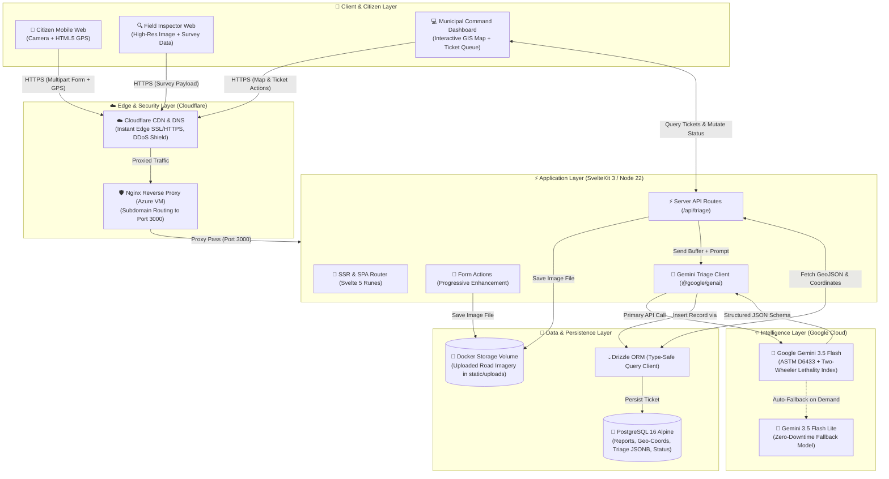
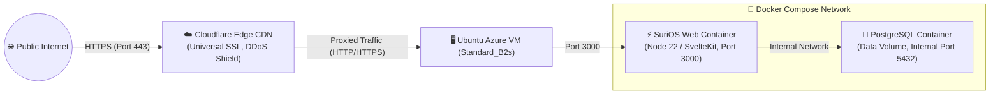

# SuriOS — System Architecture & Data Flow

This document details the end-to-end system architecture, service interactions, data flow, and infrastructure design for **SuriOS**.

---

## 1. High-Level Architecture Diagram

---

## 2. Core Subsystems

### A. 📱 Citizen & Field Capture Layer (Mobile Web)
* **⚡ Progressive Mobile Web:** Built with Svelte 5 and Tailwind CSS v4, optimized for mobile viewports (`sm:`).
* **📸 Direct Hardware Capture:** Integrates `<input type="file" capture="environment">` for immediate rear-camera access on mobile devices.
* **📍 Geolocation Ingestion:** Uses the browser `navigator.geolocation` API to capture precise latitude, longitude, and accuracy radius.
* **🏍️ Two-Wheeler Lethality Alert:** Instant visual warning banner notifying citizens if the road defect is a lethal hazard for motorcycles, tricycles, and bicycles.

### B. 🛠️ Application & Orchestration Layer (SvelteKit 3)
* **⚡ Svelte 5 Runes Reactivity:** `$state`, `$derived`, and `$effect` power surgical DOM updates with zero Virtual DOM overhead.
* **🚀 Production Node Adapter:** Built with `@sveltejs/adapter-node` compiling into a standalone Node server (`build/index.js`).
* **🔒 Server-Side Key Shielding:** Environment variables (`GEMINI_API_KEY`) are accessed strictly on the server via `$env/static/private` or Node process environment.

### C. 🧠 Intelligence & Vision Layer (Google Gemini)
* **✨ Models:** Primary `gemini-3.5-flash` with automatic fallback to `gemini-3.5-flash-lite` via `@google/genai`.
* **📊 ASTM D6433 Standards:** Formal civil distress classification (*pothole, alligator cracking, longitudinal cracking, rutting, ravelling, drainage failure*).
* **🛡️ Spam & Anti-Abuse Rejection:** Instant binary rejection for non-infrastructure imagery (e.g., indoor rooms, pets, selfies, food).
* **🏍️ Two-Wheeler Lethality Index (SDG 9.1):** Evaluates hazard rating (*NONE, LOW, MODERATE, HIGH, CRITICAL*) specifically for vulnerable road users (60%+ of Philippine road transport).
* **🔧 Action & Materials Estimation:** Recommends exact public works repair methods and generates a crew equipment checklist.

### D. 🐘 Data & Storage Layer (PostgreSQL + Drizzle ORM)
* **💧 Drizzle ORM Schema:**
  * `id`: UUID primary key (`defaultRandom()`).
  * `image_path`: Relative file path inside `static/uploads/`.
  * `latitude` & `longitude`: High-precision decimals (`DECIMAL(10, 8)` / `DECIMAL(11, 8)`).
  * `distress_type`: Standardized civil category (`pothole`, `alligator_cracking`, etc.).
  * `hazard_severity`: Integer rating from `1` to `10`.
  * `risk_level`: General risk tier (`LOW`, `MODERATE`, `CRITICAL`).
  * `vru_lethality`: Rider threat level (`NONE` to `CRITICAL`).
  * `vru_details`: Kinematic hazard explanation for two-wheelers.
  * `recommended_action`: Repair specification.
  * `materials_checklist`: `JSONB` array of required crew equipment.
  * `status`: Lifecycle enum (`REPORTED`, `DISPATCHED`, `RESOLVED`).
  * `community_confirmations`: Counter for proximity-linked citizen upvotes (~25m).
  * `resolved_image_path`: After-repair photo for Gemini "Proof of Patch" verification.
  * `triage_payload`: Full structured Gemini JSON document.
  * `created_at` & `updated_at`: UTC timestamps.

### E. 💻 Municipal Command Dashboard
* **🗺️ Interactive GIS Mapping:** Leaflet or MapLibre GL mounted cleanly inside a Svelte 5 `$effect()` block.
* **📍 Severity Color Clustering:**
  * 🟢 **Green (1–3):** Minor surface degradation (monitoring queue).
  * 🟡 **Amber (4–6):** Moderate structural defect (scheduled maintenance).
  * 🔴 **Red (7–10):** Critical safety hazard / deep pothole (emergency dispatch).
* **📋 Ticket Management Drawer:** Slide-over sheet (`shadcn-svelte`) showing original photo, AI distress diagnosis, materials checklist, and dispatch controls.

---

## 3. Infrastructure & Deployment Topology

* **☁️ Cloudflare:** DNS and Edge SSL proxy for `https://surios.site`.
* **🖥️ Azure Virtual Machine:** Ubuntu 24.04 LTS instance hosting multi-container Docker network.
* **🐳 Docker Compose:** Isolated production environment (`docker-compose.prod.yml`).
