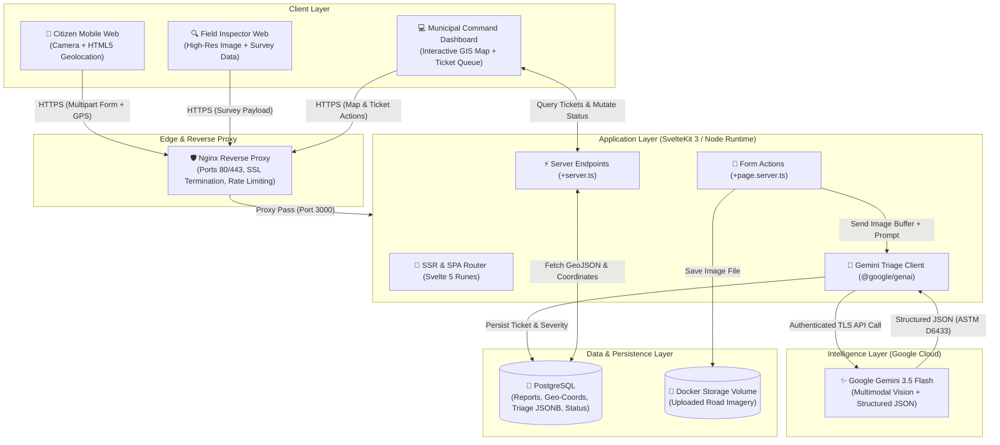
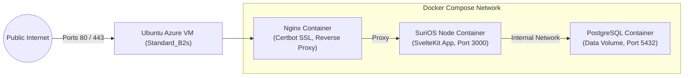

# SuriOS — System Architecture & Data Flow

This document details the end-to-end system architecture, service interactions, data flow, and infrastructure design for **SuriOS**.

---

## 1. High-Level Architecture Diagram

---

## 2. Core Subsystems

### A. Citizen & Field Capture Layer (Mobile Web)
* **Progressive Mobile Web:** Built with Svelte 5 and Tailwind CSS, optimized for mobile viewports (`sm:`).
* **Direct Hardware Capture:** Integrates `<input type="file" capture="environment">` for immediate rear-camera access on mobile devices.
* **Geolocation Ingestion:** Uses the browser `navigator.geolocation` API to capture precise latitude, longitude, and accuracy radius.
* **Instant Client Feedback:** Visual loading states and preliminary severity feedback rendered using Svelte 5 fine-grained reactivity.

### B. Application & Orchestration Layer (SvelteKit)
* **Unified Full-Stack Architecture:** Single TypeScript codebase eliminating network serialization friction between client and server.
* **Progressive Enhancement:** Form actions in `+page.server.ts` utilize SvelteKit's `use:enhance` to submit photos without full-page reloads.
* **Server-Side API Key Shielding:** Environment variables (`GEMINI_API_KEY`) are accessed strictly on the server via `$env/static/private`.

### C. Intelligence & Vision Layer (Google Gemini)
* **Model:** `gemini-3.5-flash` via the official `@google/genai` SDK.
* **Standardized Prompting:** Prompts structured around **ASTM D6433 (Pavement Condition Index - PCI)** standards.
* **Spam & Anti-Abuse Filter:** Instant binary rejection for non-infrastructure imagery (e.g., indoor photos, pets, selfies).
* **Deterministic Hazard Index:** Hybrid computation combining Gemini qualitative defect extraction with deterministic server-side formula scoring (1–10).
* **Vulnerable Road User (VRU) Profiling:** Evaluates risk specifically for motorcycles, tricycles, and bicycles.

### D. Data & Storage Layer (PostgreSQL)
* **Reports Table:**
  * `id`: UUID primary key.
  * `image_path`: Relative disk path inside mounted Docker volume.
  * `latitude` & `longitude`: High-precision decimals (`DECIMAL(10, 8)`).
  * `distress_type`: Standardized civil category (`pothole`, `alligator_cracking`, etc.).
  * `severity_index`: Integer rating from `1` to `10`.
  * `status`: Lifecycle enum (`REPORTED`, `DISPATCHED`, `RESOLVED`).
  * `triage_metadata`: `JSONB` document containing materials checklist, estimated dimensions, and VRU risks.
  * `created_at` & `updated_at`: UTC timestamps.

### E. Municipal Command Dashboard
* **Interactive GIS Mapping:** Leaflet or MapLibre GL mounted cleanly inside a Svelte 5 `$effect()` block.
* **Severity Heat-Clustering:** Pins dynamically color-coded:
  * 🟢 **Green (1–3):** Minor surface degradation (monitoring queue).
  * 🟡 **Amber (4–6):** Moderate structural defect (scheduled maintenance).
  * 🔴 **Red (7–10):** Critical safety hazard / deep pothole (emergency dispatch).
* **Ticket Management Drawer:** Slide-over sheet (`shadcn-svelte`) showing original photo, AI distress diagnosis, materials checklist, and dispatch controls.

---

## 3. Infrastructure & Deployment Architecture

* **Azure Virtual Machine:** Ubuntu 24.04 LTS instance with static public IP.
* **Reverse Proxy:** Nginx handling HTTPS certificates via Let's Encrypt (Certbot) to ensure mobile browser geolocation permissions are granted.
* **Docker Compose:** Isolated container network ensuring reproducible, zero-drift deployments.
