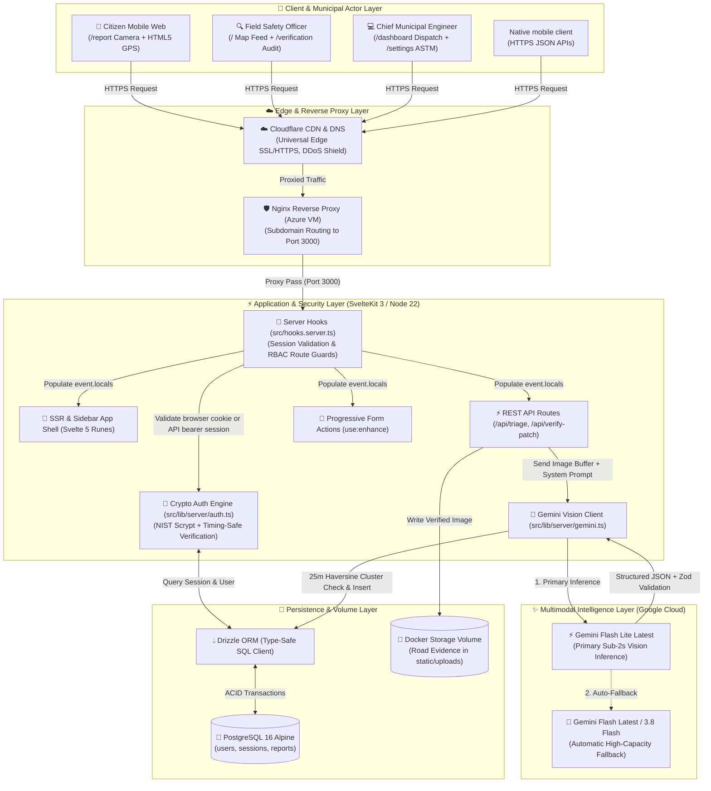
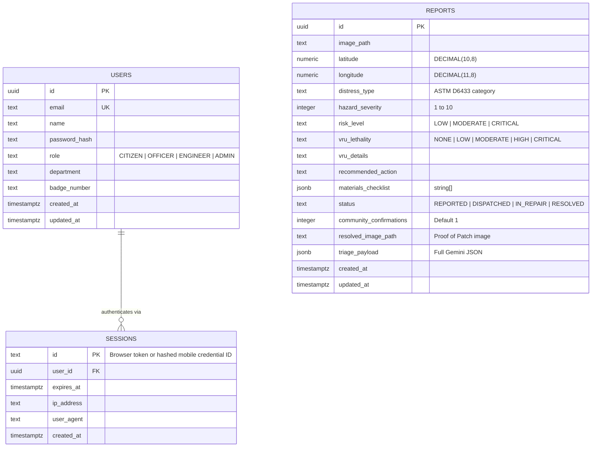
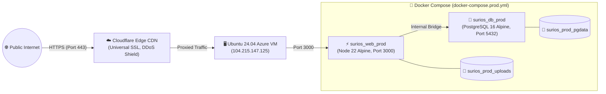

# SuriOS — System Architecture, Security & Data Flow

This document details the end-to-end system architecture, service interactions, authentication security, database schema, and cloud infrastructure design for **SuriOS**.

## Native mobile access

The React Native/Expo client can use the same SvelteKit API over HTTPS. Native
login/registration returns a revocable bearer token; only its hashed identifier
is saved in the existing `sessions` table. Browser cookie sessions remain
separate client credentials for the same user accounts. Password reset,
deactivation and approval checks apply across both clients.

`src/hooks.server.ts` resolves bearer credentials only on API routes and retains
same-origin protection for cookie mutations. Optional exact-origin CORS supports
browser previews without enabling cross-origin cookies. Public and private JSON
reads, existing reporting/social mutations, government updates and administrator
decisions all reuse the website's data and permission rules. The API contract and
complete route list are in [MOBILE_API.md](./MOBILE_API.md).

The mobile app never connects directly to PostgreSQL, SMTP or Gemini. The backend
owns those secrets and operations. This web revision exposes the server contract;
the separate mobile repository must implement calls to it.

---

## 1. High-Level System Architecture Diagram

---

## 2. Core Architectural Subsystems

### A. 🔐 Authentication & Municipal RBAC Subsystem (`src/lib/server/auth.ts` & `src/hooks.server.ts`)
* **Zero-Dependency Native Cryptography:** Uses Node.js built-in `node:crypto` (`scryptSync` with a 16-byte random salt and `timingSafeEqual` constant-time comparison) to eliminate native C++ addon compilation failures in Alpine Docker containers while guaranteeing NIST-grade password security.
* **Sliding-Window Database Sessions:** 32-byte random hex tokens stored in the `sessions` table with a 30-day expiration window that automatically renews when less than 15 days remain.
* **Development Demo Seeding (`ensureInitialSeedUsers`):** Development initialization seeds test accounts only when `users` is empty. Production does not seed on startup; the explicit presentation seed and administrator bootstrap are documented in the Docker runbook.
* **Native API Sessions:** Login/signup can issue a random bearer credential whose SHA-256 identifier is stored with a `mobile:` prefix in the same sessions table. API requests resolve the same user/approval rules without setting browser cookies. Revocation and password changes cover both session types.
* **Server-Side Route Guards:** `src/hooks.server.ts` intercepts unauthenticated requests to protected operational routes (`/dashboard`, `/profile`, `/settings`) and issues an HTTP `303` redirect to `/login?redirectTo=...`.

### B. 🧱 Authentic `shadcn-svelte` Sidebar Application Shell (`src/routes/+layout.svelte`)
* **Collapsible Desktop & Mobile Shell:** Persistent left sidebar (`w-64`) on desktop and a slide-over `<Sheet side="left">` drawer on mobile viewports, categorized into:
  1. **Operations & GIS:** Map Feed (`/`), Dispatch Canvas (`/dashboard`), Field Report (`/report`).
  2. **Municipal Modules:** Proof of Patch (`/verification`), Road Analytics (`/analytics`), Contractors & Crews (`/crews`), Community Hub (`/community`).
  3. **Standards & Policy:** Civil Standards (`/docs`).
  4. **Personnel & Account:** Profile (`/profile`), Settings (`/settings`).
* **Zero-Flicker Theme Engine:** Pre-hydration inline script in `src/app.html` combined with OKLCH semantic tokens in `src/routes/layout.css` ensures 100% parity between Dark Mode (`#09090b`) and Light Mode (`#ffffff`).

### C. 🧠 Multimodal Vision & Civil Triage Pipeline (`src/lib/server/gemini.ts`)
* **Resilient Multi-Model Fallback Chain:** Sequentially attempts `gemini-flash-lite-latest` $\rightarrow$ `gemini-flash-latest` $\rightarrow$ `gemini-3.8-flash` via `@google/genai` with `responseMimeType: 'application/json'`.
* **Dual-Stage Validation:**
  1. **Spam & Non-Infrastructure Gate:** Rejects selfies, indoor rooms, pets, and media that does not show recognizable public infrastructure (`isValidInfrastructure: false`), returning HTTP `422` without polluting the database.
  2. **Zod Schema Enforcement (`TriageAnalysisSchema`):** Normalizes enum casing and enforces safe defaults so malformed fields never crash the server.
* **ASTM D6433 & VRU Lethality Profiling:** Categorizes pavement distress (*pothole, alligator cracking, longitudinal/transverse cracking, rutting, ravelling/weathering, drainage failure, edge break*) and evaluates specific kinematic threats to motorcycles, tricycles, and bicycles.

### D. 📍 Spatial GIS & Proximity Geo-Clustering Layer (`/` & `/dashboard`)
* **SSR-Safe Leaflet Integration:** Dynamically imports `leaflet` inside a Svelte 5 `$effect()` hook only when `typeof window !== 'undefined'`, paired with high-contrast Carto Voyager vector tiles anchored at **Santa Cruz, Laguna (`14.2813° N, 121.4173° E`)**.
* **Numeric Severity Marker Encoding:** Adhering to our Zero AI-Slop Charter (no decorative status dots), map pins render the exact numeric **Hazard Severity Index (`1` to `10`)** inside a crisp bordered badge:
  * **Low (`1–4`):** Neutral Slate (`#64748b`) — Routine monitoring & crack sealing.
  * **Moderate (`5–7`):** Warning Amber (`#f59e0b`) — Scheduled cold/hot mix patching.
  * **Critical (`8–10`):** Destructive Red (`#ef4444`) — Urgent review for severe visible infrastructure hazards with clear public exposure.
* **Haversine `~25m` Deduplication:** Proximate reports of the same defect merge into a single canonical ticket, incrementing `community_confirmations` as a priority multiplier.

---

## 3. Database Entity-Relationship Schema (`src/lib/server/db/schema.ts`)

---

## 4. Cloud Infrastructure & Deployment Topology

* **Local vs. Production Port Isolation:** Local PostgreSQL runs on port `5433` (`surios_local_db` in `docker-compose.yml`) to prevent collisions with existing host services on `5432`, while production runs over an isolated internal Docker bridge (`db:5432` in `docker-compose.prod.yml`).
* **HTTPS Geolocation Compliance:** Cloudflare Universal SSL terminates HTTPS at the edge for `https://surios.site`, satisfying mobile browsers' strict secure-context requirement for `navigator.geolocation` and camera hardware access.

Public community profile views at `/community?profile=<id>` select only public identity and authored posts. The owner route `/profile` still requires authentication. Photo editing and comment/reply mutations require an authenticated session and same-origin requests; see [Community profiles](./COMMUNITY_PROFILES.md).
