# SuriOS — Master 3-Phase Roadmap & Orchestrator Plan

This document defines the phased execution roadmap, architectural milestones, and orchestrator recommendations for **SuriOS**.

> Government update: the separate verification and analytics demo pages below
> are retired plans, superseded by the user's single-workspace requirement.
> [GOVERNMENT_WORKSPACE.md](./GOVERNMENT_WORKSPACE.md) is the current scope:
> Government updates publishes In progress/Resolved quotes, photo/PDF evidence,
> itemized budgets, municipal/barangay profiles and distinct-report statistics.
> Crew assignment and dimensional material calculation have been retired. Do not recreate redundant government pages or treat
> the older simulated engineering metrics as implemented measurements.

---

## 1. Phased Execution Overview

```mermaid
flowchart LR
    subgraph P1["✅ Phase 1: Auth, RBAC & App Shell (Completed)"]
        P1A["PostgreSQL users & sessions Schema"]
        P1B["NIST Scrypt + Timing-Safe Auth"]
        P1C["SvelteKit Route Guards & Seed Accounts"]
        P1D["Authentic shadcn Sidebar + 10-Route Sitemap"]
    end

    subgraph P2["🚀 Phase 2: Inside Content & Live Operations (Next)"]
        P2A["Full AI Triage Telemetry in /report"]
        P2B["25m Haversine Geo-Clustering in /api/triage"]
        P2C["Live DB Dispatch Actions in /dashboard"]
        P2D["Interactive Map + CSV Work Order Export"]
    end

    subgraph P3["🏁 Phase 3: Proof-of-Patch, Analytics & Final Polish"]
        P3A["Gemini Dual-Image Proof-of-Patch (/verification)"]
        P3B["Degradation Cost Calculator (/analytics)"]
        P3C["Crew Roster & Community Hub (/crews, /community)"]
        P3D["Zero AI-Slop Audit & Azure Production Rollout"]
    end

    P1 --> P2 --> P3
```

---

## 2. Phase-by-Phase Breakdown & Checklist

### ✅ Phase 1: Authentication, Municipal RBAC & Sidebar App Shell *(Completed)*
* **Database & Auth Core:**
  * [x] `users` and `sessions` tables in PostgreSQL with Drizzle ORM migrations (`drizzle/0001_lumpy_magus.sql`).
  * [x] Salted `scrypt` password hashing (`node:crypto`) + constant-time `timingSafeEqual` verification.
  * [x] Auto-seeding 3 demo accounts (`engineer@surios.gov`, `inspector@surios.gov`, `citizen@surios.gov`).
  * [x] Server hooks (`src/hooks.server.ts`) enforcing session validation and route protection.
* **Application Shell & Core Views:**
  * [x] Authentic `shadcn-svelte` collapsible desktop sidebar & mobile `<Sheet>` drawer (`src/routes/+layout.svelte`).
  * [x] Split-screen **Map Feed** homepage (`/`) with Leaflet + Carto Voyager tiles and slide-over inspection drawer.
  * [x] **Civil Staff Profile** (`/profile`) with role privileges, stats, profile editor, and password rotation.
  * [x] **System Settings** (`/settings`) with theme control, VRU alert switches, ASTM depth sliders, and AI health diagnostics.
  * [x] Reusable `EmptyState` indicator (`src/lib/components/ui/empty-state.svelte`) deployed on `/verification`, `/analytics`, `/crews`, and `/community`.

---

### 🚀 Phase 2: Inside Content, Live Database Wiring & Operations *(Immediate Next Target)*
Phase 2 transforms static/mock inside content into a 100% live, database-driven municipal command center.

1. **Upgrade `/report` (Citizen & Inspector Field Shutter) with Rich Triage Telemetry:**
   * **Current Gap:** `/report` currently shows a simple *"Report Dispatched Successfully"* confirmation card without displaying the rich Gemini AI diagnosis returned by `POST /api/triage`.
   * **Improvement Plan:**
     * Render the full **ASTM D6433 Diagnosis Card** upon submission: Distress Category, Hazard Severity ($1-10$), Two-Wheeler Lethality Alert banner, Estimated Depth/Area, and Recommended Repair Materials.
     * Handle HTTP `422` non-infrastructure rejections gracefully by showing the exact `rejectionReason` from Gemini Vision so the user knows why a non-road photo was blocked.
     * Add a direct **"View Pin on Live Map Feed"** button that navigates to `/?highlight={reportId}`.

2. **Implement True `~25m` Haversine Proximity Geo-Clustering in `POST /api/triage`:**
   * **Current Gap:** Every submission to `POST /api/triage` currently inserts a new row with `communityConfirmations: 1`.
   * **Improvement Plan:**
     * Before inserting, query unresolved reports within $\pm 0.0003^\circ$ latitude/longitude.
     * Calculate exact Haversine distance in meters. If an active defect of the same class exists within $25\text{m}$, increment `community_confirmations` on the existing ticket and return `clustered: true`.
     * Add a `POST /api/reports/[id]/confirm` endpoint so citizens browsing the Map Feed (`/`) can tap **"+1 Confirm Hazard"** on any existing pin.

3. **Wire Live Database Mutations & Interactive GIS Map into `/dashboard` (Dispatch Canvas):**
   * **Current Gap:** `/dashboard` loads `dbReports` in `+page.server.ts`, but the UI table still iterates over a hardcoded `incidents` array and the "Assign Crew" / "Export CSV" buttons are static.
   * **Improvement Plan:**
     * Merge live `data.dbReports` with baseline Santa Cruz telemetry in `/dashboard/+page.svelte`.
     * Mount a synchronized Leaflet GIS map in the `/dashboard` canvas (replacing the placeholder wireframe box) that pans/zooms when a dispatcher clicks a row in the table.
     * Add server actions in `/dashboard/+page.server.ts`:
       * `?/updateStatus`: Transitions ticket state (`REPORTED` $\rightarrow$ `DISPATCHED` $\rightarrow$ `IN_REPAIR` $\rightarrow$ `RESOLVED`) with RBAC verification (`OFFICER` / `ENGINEER`).
       * Client-side **Export CSV Work Orders** function generating an instant downloadable `.csv` manifest for DPWH field crews.

---

### 🏁 Phase 3: Proof-of-Patch Verification, Analytics & Final Polish *(Final Target)*
Phase 3 activates the remaining specialized modules and prepares the platform for the final Hackathon Pitch & Azure production audit.

1. **Activate `/verification` (Gemini "Proof of Patch" Sign-Off Archive):**
   * Build `POST /api/verify-patch` and `verifyRoadPatch()` in `src/lib/server/gemini.ts`.
   * Allow field officers/engineers to select a `DISPATCHED` or `IN_REPAIR` ticket, upload an after-repair photo, and receive a 3-point AI audit (**Surface Planarity**, **Edge Tacking**, **Void Elimination**) before transitioning the ticket to `RESOLVED`.

2. **Activate `/analytics`, `/community`, and `/liked` (with Overscoped `/docs` and `/crews` Pruned):**
   * **`/analytics` (Gov Only):** Live breakdown of defects by ASTM category, 5-year PCI decay curves, and the **Preventative vs. Reactive Cost Savings Calculator** (\$1 saves \$6–\$10).
   * **`/community` & `/liked` (Community Only):** Single-column Swiss Minimalist social stream with vertical inset media dock, top citizen safety contributors, and personal liked/confirmed hazard tracking.
   * **Scope Discipline:** Standalone `/docs` ("Civil Standards") and `/crews` ("Contractors & Crews") pages were removed to prevent feature bloat; crew assignment is built directly inline into `/dashboard`.

3. **Final Zero AI-Slop & Mobile Responsiveness Audit:**
   * Verify zero gradients, zero neon glows, zero green status dots, 100% light/dark mode parity, and $\ge 48\text{px}$ mobile touch targets across all 10 routes.

---

## 3. High-Impact Orchestrator Suggestions (Competitive Differentiators)

To maximize scoring on the **ITEL 304 Hackathon Pitch Evaluation Rubric (100 Points)**, the following strategic refinements are recommended:

| Suggestion | Target Module | Why It Wins Judge Points |
| :--- | :--- | :--- |
| **1. One-Click Demo Sample Images on `/report`** | `/report` | During a live desktop pitch or Q&A, judges may not have a pothole photo on their laptop. Adding 3 one-click *"Load Sample Road Photo (Deep Pothole / Alligator Crack / Non-Road Spam)"* buttons lets anyone test the live Gemini API in 1 click. |
| **2. Preventative Cost Savings Telemetry on `/dashboard`** | `/dashboard` & `/analytics` | Directly satisfies **Criterion 3 (Impact & Sustainability - 30%)** by translating each early-stage repair into quantifiable PHP ($\₱$) municipal budget savings compared to full-depth road reconstruction. |
| **3. One-Click "+1 Confirm" Button on Map Feed Cards** | `/` (Map Feed) | Demonstrates the **Community Consensus** loop live during the demo—clicking confirm immediately increments the confirmation counter and boosts priority. |
| **4. Side-by-Side Before/After Comparison in `/verification`** | `/verification` | Directly proves **SDG 16 (Accountable Institutions)** and **SDG 9** by showing how AI prevents "ghost repairs" and contractor corruption. |
