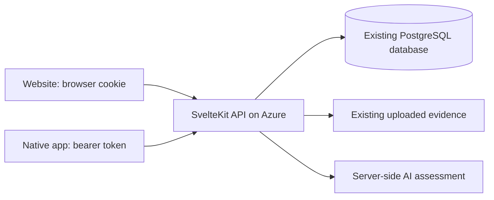

# SuriOS API for web and native mobile clients

This backend provides JSON access to the website's existing features. The mobile
app uses these endpoints over HTTPS; the SvelteKit server remains responsible for
accounts, PostgreSQL, Gemini, file validation, issue grouping and government
resolution. Adding these endpoints does not itself connect a mobile app: its
developer must implement the HTTP calls and screens against this contract.



## Base URL and requests

Use the deployed website origin as the API base URL, for example
`https://surios.site`. Paths below already include `/api`. A native app only needs
this public URL; database credentials, SMTP credentials and Gemini keys stay on
the server. There is no second mobile database or required API key for clients.

For local testing on a physical phone, use the development computer's LAN address
and SvelteKit port, such as `http://192.168.1.20:5173`, with the server listening
on `0.0.0.0`. The phone's `localhost` is the phone itself. Use HTTPS in production.

Send `Accept: application/json`. JSON request bodies require
`Content-Type: application/json`; the account/settings JSON limit is 16 KiB.
For file uploads, use multipart `FormData` and let the HTTP client generate its
content type and boundary. Relative media URLs such as `/media/<uuid>.jpg` must
be resolved against the backend origin, including avatars, covers and PDFs.

Errors normally contain `{ "message": "Explanation" }`. The existing assessment
rejection additionally contains `analysis`; the legacy `/api/triage` and routing
APIs retain their `{ success, error }` contracts. Check HTTP status before parsing
the success shape. Relevant statuses are 400 (validation), 401 (missing/invalid/
expired session), 403 (permissions, approval or origin), 404 (missing/not owned),
409 (conflicting/stale request), 410 (expired/discarded draft), 413 (size), 415
(JSON content type), 422 (irrelevant media), 429 (quota), and 503 (unavailable
provider or email). API errors do not redirect to HTML login pages. API responses
are not cached. Dates are ISO 8601 strings.

## Authentication and account approval

| Method | Path | Request / response |
| --- | --- | --- |
| GET | `/api` | Discovery: API version, features, authentication paths and report-media limits. |
| POST | `/api/auth/login` | JSON `{ email, password }`; returns `{ accessToken, tokenType: "Bearer", expiresAt, user }`. |
| POST | `/api/auth/register` | JSON described below; same session response, HTTP 201. |
| GET | `/api/auth/session` | Signed-in account and current expiry: `{ user, expiresAt }`. Pending/rejected applicants may also call this. |
| POST | `/api/auth/logout` | Revokes this session only, returns `{ success: true }`. |
| GET | `/api/account` | Private own-account details: `{ user }`; also available to pending/rejected applicants. |
| PATCH | `/api/account` | JSON containing any of `name`, `email`, `department`, `badgeNumber`; returns `{ user }`. Active accounts only. |

Citizen signup requires `name`, `email`, `password`, and `confirmPassword`. Role
defaults to `CITIZEN`. Passwords must match and be 8–256 characters. Government
signup uses `role: "OFFICER"` and additionally requires `department`,
`jurisdiction`, and `badgeNumber`; `level` is `MUNICIPAL` (default) or `BARANGAY`.
Public signup never grants `ADMIN` or `ENGINEER`. Unknown JSON fields, including
forged approval state, are rejected. Existing email addresses return 409.

Citizens are immediately `ACTIVE`. Government applicants are `PENDING` until
approved through the existing admin workflow. Login may return a pending or
rejected account so the app can display its status, but feature APIs return 403.
Session/account reads and logout remain available. `INACTIVE` accounts cannot
sign in, and deactivation invalidates their existing sessions.

API authentication is rate-limited in the server process: 100 login requests per
IP and 20 per normalized email in 15 minutes; 20 signup attempts per IP per hour.
Clients should handle 429 without automatically retrying a loop of credentials.

After login, attach the returned credential to API requests:

```http
Authorization: Bearer <accessToken>
Accept: application/json
```

Native clients do not need cookies or a fabricated `Origin` header. Store the
token in platform-secure storage and clear it after logout or 401. It is an
opaque session credential, not a JWT to decode. Never put it
in a URL, an `EXPO_PUBLIC_` variable, analytics or logs. The server returns the
credential only when issuing it and stores only its SHA-256 identifier in the
existing sessions table. A database session identifier is not a client token.

Sessions last 30 days and renew during authenticated requests when fewer than 15
days remain. `GET /api/auth/session` provides the current expiry. No refresh-token
endpoint is needed for this session model. Tokens authorize `/api` routes only;
they do not create a browser login on `/dashboard` or `/profile`. Browser login
continues to use its HTTP-only cookie and same-origin mutation checks.

Account JSON omits password hashes, raw sessions and review identifiers. Private
email/ID fields appear only in own-account or administrator responses, never in
public profiles, posts or map data. Account patches cannot set role or approval.

Example native-style sign-in:

```bash
curl -X POST https://YOUR-SURIOS-DOMAIN/api/auth/login -H 'Accept: application/json' -H 'Content-Type: application/json' --data '{"email":"you@example.com","password":"YOUR_PASSWORD"}'
```

## Feed, search, threads and social actions

| Method | Path | Behavior |
| --- | --- | --- |
| GET | `/api/community/posts` | Combined original/repost feed; public reads, personalized with a session. |
| GET | `/api/community/posts/:id` | Full `{ post, reposts }` thread, including comments/replies, media, map coordinates, current hazard status and official-update links. |
| POST | `/api/community/posts/:id` | JSON `{ action: "like", liked: boolean }` or `{ action: "comment", body, parentId? }`. |
| DELETE | `/api/community/posts/:id` | Owner only. Soft-deletes the post and its media while retaining the hazard and official resolution history. |
| POST | `/api/community/comments/:id` | JSON `{ liked: boolean }` for a source-post comment/reply. |
| POST | `/api/community/reposts` | Multipart social repost or government update, described below. |
| GET | `/api/community/reposts/:id` | `{ repost }`, including the original post, optional quoted update and its own discussion/reaction counts. |
| POST | `/api/community/reposts/:id` | Quote-specific JSON `{ action: "like", liked }` or `{ action: "comment", body, parentId? }`. |
| POST | `/api/community/reposts/:id/comments/:commentId` | JSON `{ liked: boolean }` for a quote comment/reply. |
| DELETE | `/api/community/reposts?id=<uuid>` | Owner-only social repost removal. Official updates are retained as public history. |

All mutations require an active session. A comment/reply is 1–1,000 characters;
`parentId` must reference a comment on that same source post or quote. Reads
include discussion, so no HTML page scraping or separate comments read is needed.

Feed query parameters:

- `q`: search text; `author`: author UUID.
- `tab=critical` or `tab=liked`; liked results need an authenticated user.
- `media=photo` or `media=video` (ignored for the liked view).
- `sort=newest|oldest|relevance|severity|likes`.
- `page=1..50`: cumulative pages of 20 combined items.

The response contains `feed`, `posts`, `reposts`, `total`, `hasMore`,
`currentPage`, and `filters`. Render `feed`, whose entries have `kind: "post"` or
`kind: "repost"`. Replace the loaded collection when requesting the next page:
page 2 returns the first 40 items, not only items 21–40. Do not append duplicates.
The separate arrays support existing website callers.

For a social repost, send multipart `id` (a client-generated UUID), `postId`,
optional `body` (up to 1,000 characters), optional `quotedRepostId`, and zero/one
`image` file (JPEG/PNG/WebP, at most 5 MiB). Reusing the same request UUID is
idempotent. Reposting a government update sets its `quotedRepostId` and does not
include `status`. Likes, replies and reposts never raise physical severity or
the count of independent hazard observations.

Native sharing uses the device share sheet with a public link:
`/community/post/<postId>` or
`/community/post/<postId>?repost=<repostId>#repost-<repostId>`. Sharing a link is a
device action; saving a repost uses the endpoint above. The `governmentUpdateLink`
on source posts is a public website link; native navigation can instead fetch
the linked quote by its repost ID.

## Reporting, assessment and maps

| Method | Path | Behavior |
| --- | --- | --- |
| POST | `/api/community/assess` | Assesses multipart evidence and reporter context, then saves an owned assessment draft. |
| DELETE | `/api/community/drafts/:id` | Cancels/discards an owned unpublished draft; idempotent 204. Published media is preserved. |
| POST | `/api/community/posts` | Publishes a current assessed draft, returning the saved post ID and canonical report ID; HTTP 201. |
| GET | `/api/map/hazards` | Public lightweight map snapshot; up to 300 markers without full evidence. |
| GET | `/api/map/reports` | Public full map data: `{ hazards, asOf }`, up to 1,000 latest hazards. |
| GET | `/api/map/reports/:id` | `{ hazard, asOf }`, including analysis, evidence, geometry and linked source posts. Direct lookup also supports older hazards. |
| GET | `/api/roads?lat=<latitude>&lng=<longitude>` | Authenticated nearby OpenStreetMap road ways; rate-limited to one request/second/user. |

The reporting sequence is:

1. Send files under repeated multipart `media` fields, with `headline` and
   `caption`. Optionally supply a UUID `X-Assessment-Id` header so an in-flight
   request can be cancelled using the same draft ID. Limits: 1–6 files, 5 MiB per
   photo, 25 MiB per video, 50 MiB total; types are listed by `GET /api`.
2. Read `{ draftId, media, analysis, context }`. Use the returned context, including
   a suggested headline if the submitted headline was empty. The server alone
   evaluates evidence, classification and severity. No client-supplied AI result
   is accepted for publication. Allow time for upload plus server assessment.
3. Choose a cover from `media`, a named location and a point or mapped road section.
4. Publish JSON with `draftId`, `coverId`, `title`, `body`, `locationName`,
   `latitude`, and `longitude`; optional `road` is `{ id: "<OSM way id>", start,
   end }`, with distances in metres. The backend verifies a 5–500 m section using
   real OSM geometry. Coordinates and road arrays use latitude/longitude order.
5. Refresh the saved post/map from the backend. Exact retries of a published draft
   return the same post, instead of adding duplicate evidence.

`title` and `body` must match the assessed context. Changing text or attachments
requires discarding the old draft and assessing again. Drafts expire after 24
hours; discarded drafts still count toward the 12-assessments/hour quota. A 422
response explains why evidence was rejected. A 503 provider/road-data error
should retain the user's form for retry. Road lookup failure can fall back to a
point pin. The current street map does not require a paid map style API key;
retain OpenStreetMap attribution.

Road sections locate a reported issue and remain available across supported
asset categories; they do not certify damage across a whole road. Assessment
also covers bridges/footbridges, drainage, lighting/poles, water utilities,
telecom, and recognizable other public infrastructure. Only pavement uses ASTM
terminology. Reporter claims alone cannot establish hidden damage or critical
danger. Existing grouping rules, canonical severity and shared resolution remain
authoritative for every client.

## Profiles, settings and passwords

| Method | Path | Request / response |
| --- | --- | --- |
| GET | `/api/profile` | Own public profile, `isOwner`, feed and government statistics. Requires active session. |
| GET | `/api/profiles/:id` | Public profile/feed/statistics; never exposes private email/ID details. Supports `page`/`sort`. |
| POST | `/api/profile` | Multipart `name`, optional `avatar`/`cover`, `removeAvatar`/`removeCover` as `"true"`; returns `{ profile }`. |
| GET | `/api/settings` | `{ preferences, email, mailAvailable }`. |
| PATCH | `/api/settings` | JSON with any of `emailComments`, `emailConfirmations` (booleans), `theme` (`light`, `dark`, `system`); returns saved settings. |
| POST | `/api/auth/password` | JSON `{ currentPassword, newPassword, confirmPassword }`; retains the current session and revokes all other native/browser sessions. |
| POST | `/api/auth/forgot-password` | Public JSON `{ email }`; neutral `{ message }` for known/unknown addresses. |
| POST | `/api/auth/reset-password` | Public JSON `{ token, newPassword, confirmPassword }`; single-use reset and revocation of all sessions. |
| POST | `/api/settings/reset-link` | Signed-in reset-link request; reports SMTP delivery failure explicitly. |

Profile images must be JPEG/PNG/WebP, at most 4 MiB each. Government profiles can
also submit multipart `governmentLevel`, `jurisdiction`, and `bio` (up to 500
characters). Citizen requests cannot add office details. Government statistics
count distinct hazards, attributed to their latest official update.

Changed/reset passwords must match and be 8–128 characters. Recovery uses the
existing `APP_ORIGIN`/SMTP configuration. Without mail configuration it returns
503; it never claims an email was sent. Reset tokens expire in 30 minutes, live
only as hashes in the database and are supplied in the request body, never a
query string. Existing email links open `/reset-password#token=...` on the website;
an app-specific deep-link experience still requires mobile-client setup.

## Government response and administrator functions

| Method | Path | Behavior |
| --- | --- | --- |
| GET | `/api/government/posts` | Government queue, matching dashboard search/filters; `posts` deduplicated by canonical report within the loaded set. |
| POST | `/api/community/government-media` | Stage one multipart `file`; returns `{ id, media }`, HTTP 201. |
| DELETE | `/api/community/government-media?id=<uuid>` | Discard an owned, unpublished staged attachment. |
| POST | `/api/community/reposts` | Multipart official update using the fields below. |
| GET | `/api/government/export` | Same protected CSV export as the website; returns `Content-Disposition` filename. |
| GET | `/api/admin/accounts` | Administrator-only account list, including applications and private government ID details. |
| PATCH | `/api/admin/accounts/:id` | Administrator-only JSON `{ decision: "approve"|"reject"|"activate"|"deactivate" }`. |

Government APIs require `OFFICER`, `ENGINEER`, or `ADMIN` with active approval.
Stage each evidence file individually: JPEG/PNG/WebP photos at most 5 MiB, PDFs
at most 4 MiB. Stage as many as needed and supply the returned IDs when publishing;
there is no four-file gallery cap for this staging workflow. Staged files expire
after 24 hours and are claimable only by their owner.

An official multipart repost contains `id` (UUID), `postId`, nonempty `body`,
`status` (`IN_PROGRESS` or `RESOLVED`), `evidenceIds` (a JSON array of staged IDs),
optional `budget` (JSON array of `{ label, amount }`, up to 20 positive PHP values
with two decimal places), and `budgetType` (`ESTIMATED` or `ACTUAL`). Older direct
multipart `evidence` uploads remain supported with their existing 1–4 file/
12 MiB aggregate limit. Use staging for larger galleries.

Publication atomically saves the government explanation, evidence, budget, audit
event and canonical status. `IN_PROGRESS` becomes stored `IN_REPAIR`; `RESOLVED`
closes every source post linked to that same report. Each linked post points to
the latest official explanation. Unrelated nearby reports stay unchanged.
Government posts support the same quote reactions/discussion/reposts as above.

Administrator approval/rejection only applies to pending government accounts.
Activation/deactivation applies to the matching inactive/active state, including
citizens. Stale decisions return 409. Admin accounts cannot be changed through
this endpoint. Rejection/deactivation immediately revokes all sessions.

## Browser previews and deployment

Native apps need no CORS configuration. For a browser-based Expo preview, set the
optional backend variable `API_ALLOWED_ORIGINS` to a comma-separated exact
allowlist, such as `http://localhost:8081,http://127.0.0.1:8081`. Scheme/host/port
must match. Wildcards and `null` are not accepted. Cross-origin browser clients
use bearer tokens, not cookies. Preflight supports GET/POST/PATCH/DELETE and
`Authorization`, `Content-Type`, `X-Assessment-Id`. Existing cookie mutations
still require the website's own origin, even for allowlisted browser previews.

The production Compose file passes this optional variable. Build/deploy the web
revision through `./surios.sh build` after reviewing/merging it. This API work adds
no schema migration, requires no reseed or account reset and uses existing Azure
database/upload volumes. Apply any already-pending repository migrations through
the normal build command. Set the mobile base URL only after the deployed API
responds. HTTPS proxy/body-size configuration must continue supporting the
existing 50 MiB reporting flow. SMTP is only needed for email features.

The Docker entrypoint runs `scripts/serve.mjs`; for a manual production start use
`npm start`, rather than bypassing it with `node build`. This retains the Node
adapter's server and shutdown handling while preparing explicit bearer requests
before SvelteKit's production form-origin gate. Their body content type is
restored only after session validation in the hook. The actual Origin header is
preserved, and cookie-only forms keep the normal CSRF check. This supports native
multipart uploads and bodyless DELETE/logout without weakening browser forms.
The loopback production-preview launcher uses the same preparation. See the
[adapter documentation](https://svelte.dev/docs/kit/adapter-node) for server and
shutdown integration.

The older `/api/triage` single-photo save, `/api/route` dispatch routing, and
`/api/route/snap` coordinate lookup remain available. Triage also accepts an
active bearer session without an Origin header, but new mobile reporting should
use the assessment-draft/publication sequence. Routing retains its existing
external-service behavior and `{ success, route|snapped|error }` responses.
Retired crew assignment, material calculator and separate verification/analytics
pages remain retired; they are not separate mobile features.

Camera capture, device GPS, opening a posting modal, map filter controls, native
sharing and print-to-PDF are client/device interactions. Their saved data is
served by the APIs above; they do not require separate server actions.

## Verification and handoff

Use a disposable, migrated local PostgreSQL database. The focused integration
suite covers native HTTP requests, shared browser sessions, strict origin/CORS,
hashed token storage, expiry/revocation, real multipart uploads, assessment drafts,
social actions, linked-hazard resolution, profile privacy, administration, SMTP
recovery, oversized/chunked JSON and logout. Gemini is replaced by the existing
loopback test transport; no paid AI calls are made.

```bash
npm run check
npx playwright test -c playwright.mobile.config.ts
npx playwright test -c playwright.mobile-production.config.ts
npm run test:community
npm run build
```

The tests read `DATABASE_URL` from their environment, as existing suites do. The
focused server uses port 5183 and mock Gemini 5198; do not run it alongside the
full suite using the same mock port. The production suite builds the app and
exercises the same cases on localhost:5184, including real form-origin behavior
that development skips. All mobile-client code and token storage
implementation remain work for the mobile repository.
